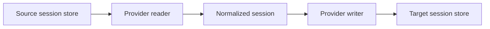

# Session migration guide

This guide covers export formats, conversion options, retained context and saved child sessions. For installation and the usual workflow, start with the [README](../README.md).

For moving a session between computers, see the [portable format guide](portable-format.md). For terminal and browser controls and Qoder-specific behavior, see [interactive interfaces](interfaces.md).

## Continue a web chat

ChatGPT, claude.ai and Gemini have no import, but each offers a data export. harness-bridge reads that export as a read-only source, so a web chat becomes a native session you can continue in Claude Code or another harness. Chats only move out of the web apps; claude.ai web and the mobile apps cannot receive them.

| App | Request the export | Provider |
| :-- | :-- | :-- |
| ChatGPT | Settings > Data controls > Export data | `chatgpt` |
| claude.ai | Settings > Privacy > Export data | `claude-web` |
| Gemini | Google Takeout > My Activity > Gemini Apps, with Activity records set to JSON under Multiple formats | `gemini-web` |

Each app emails a download link. harness-bridge reads the zip as it is, an extracted folder, or the conversations file; extract a `.tgz` first. For Gemini, the top-level "Gemini" Takeout item holds only Gems, and HTML activity cannot be read.

List the chats in an export. The app is detected from its contents:

```sh
harness-bridge list --export chatgpt-export.zip
```

Preview, then write one chat. `--cwd` is required because web chats have no working directory, and the files a chat refers to are copied there:

```powershell
harness-bridge migrate "Fridge energy math" --from chatgpt --to claude --export chatgpt-export.zip --cwd "D:\chats\fridge" --dry-run
harness-bridge migrate "Fridge energy math" --from chatgpt --to claude --export chatgpt-export.zip --cwd "D:\chats\fridge"
```

Resume it from that folder with `claude --resume <native id>`, or open it from the Claude Desktop Code tab, where the chat is registered.

What carries over:

- The visible branch of each chat. ChatGPT and claude.ai keep every edit and regeneration; the branch you last saw is the one migrated.
- Code runs, web results, image generation and other tool use, as tool calls with their output. A call with no recorded output gets an explicit empty result, and output with no call stays as text.
- Reasoning summaries, as reasoning. Hidden model state is not in the exports.
- Text that claude.ai extracted from uploaded documents, inline in the prompt.
- Uploaded files and generated images that the export contains, copied to `<cwd>/<provider>-attachments/<chat id>/` and referenced by that path so the destination can open them. Files the export left out are named as missing.

Gemini's Takeout is an activity log of single prompts and answers. Records are grouped into chats by the chat id in their link, and records without one are grouped while less than 30 minutes apart.

Web chats can also be written to a portable file and imported on another machine running 0.4.0 or later. The file keeps the attachment references but not the files.

## Options

| Option | Purpose |
| :-- | :-- |
| `--from`, `--to` | Source and destination: `dsh`, `codex`, `claude`, `zcode`, `agy`, or `qoder`; `qoder-ide`, `chatgpt`, `claude-web` and `gemini-web` as sources only. |
| `--json` | Structured output for commands, including listings and provider diagnostics. |
| `list --query`, `--limit` | Filter title, id, provider or folder and limit the newest-first results. |
| `--export` | Web chat export for the web sources: the zip, its extracted folder, or the conversations file. `list --export` detects the app. |
| `--cwd` | Set the destination's base directory; defaults to the source directory. Required for web sources, whose attachments are copied there. Paths inside messages are left as recorded. |
| `--name` | Override the destination's display title. |
| `--dry-run` | Read and convert without writing. Required target templates are still read. |
| `--resume-max-chars` | Retained-context character budget; defaults to 750,000. This is a preflight limit, not a token count. |
| `--prune-resume-context` | Explicitly allow shortening reasoning and tool outputs to fit the budget. Preserve the complete normalized archive, prompts, assistant text, tool arguments and call ids. |
| `--rebuild-resume-context` | Import/migrate only: explicitly reconstruct unavailable context from readable checkpoint items or the transcript. Encrypted state is omitted with a recovery notice; budgets still apply. |
| `--include-subagents` | Import saved children recursively, preflight the entire family, and remap parent links. |
| `--preset` | Copy a DSH session to an installed directory preset; valid only with `--from dsh --to dsh`. |
| `--dsh-home`, `--codex-home`, `--claude-home` | Override a provider's home directory, including for isolated validation. |
| `--zcode-db`, `--agy-dir` | Override ZCode's database or agy's data directory. |
| `--qoder-home`, `--qoder-ide-db` | Override Qoder's home and read-only IDE/desktop database. |

Run `harness-bridge --help` or `harness-bridge migrate --help` for the full command reference.

<details>
<summary><strong>Default storage locations</strong></summary>

Paths are relative to the user's home directory.

| Provider | Location |
| :-- | :-- |
| dsh | `~/.dsh/sessions/<project>/<id>/session.v4.jsonl[.zstd]` |
| Codex | `~/.codex/sessions/YYYY/MM/DD/rollout-*.jsonl` |
| Claude Code | `~/.claude/projects/<project>/<id>.jsonl` |
| ZCode | `~/.zcode/cli/db/db.sqlite` |
| agy | `~/.gemini/antigravity-cli` |
| Qoder CLI | `QODER_CONFIG_DIR` or `~/.qoder/projects/<project>/<id>.jsonl` |
| Qoder IDE | `~/.qoder/projects/<project>/transcript/<id>.jsonl`; desktop database override with `--qoder-ide-db`. |

</details>

## How conversion works



Every provider implements discovery, reading, writing, and child discovery. The shared [session model](../src/ir.rs) carries the archive and, when available, a separate set of events representing the source's current model context. The destination writer translates those records into native messages and tool items, then performs any registration its app needs. Claude and DSH writes add native context checkpoints; ZCode keeps archival messages visible in the transcript but hidden from the provider. agy writes retained text turns and stores the normalized archive separately in `brain/<id>/migration-archive.json`.

Codex writes also update `session_index.jsonl`, the `threads` table in `state_5.sqlite` when present, and `dsh-imports.json`. This lets the Desktop app find imported chats without relying on its initial rollout backfill.

## Resuming in Codex

Source transcripts can retain records from before compaction. Sending that entire log on resume can exceed the model's context window. Claude's latest compact boundary, summary and declared preserved messages, DSH's ordered surface replacements, Codex's plaintext replacement history, and ZCode's persisted summaries are read as retained context.

The DSH reader replays `surfaceOp` replacements in their actual context order and retains the tool calls paired with surviving results. The Codex writer keeps the full converted transcript for display and adds a native `compacted` record containing the retained context. Migration output reports `resume_context_items` and `resume_context_chars` when this metadata is available.

Imported reasoning remains visible in the Codex transcript, while the resume checkpoint represents it as labeled assistant text. The normalized model cannot transfer the originating service's signed or encrypted hidden state. This applies to every source provider, including uncompacted sessions and normalized Codex reads. Replaying synthesized native reasoning can otherwise cause `unsupported_persisted_item_context` on a later response continuation.

Compacted DSH transcripts without authoritative surface operations and Codex checkpoints without plaintext replacement history fail with an explanation instead of replaying the archive. Uncompacted sources use their full context and the same size preflight.

When retained context exceeds the budget, compact the source or explicitly allow output pruning:

```sh
harness-bridge migrate "<id-prefix>" --from claude --to codex --prune-resume-context --include-subagents --dry-run
```

Pruning retains a notice and the beginning/end of shortened tool outputs; it is not a generated summary. If protected messages or arguments still exceed the budget, the import stops before writing. `--resume-max-chars` can be adjusted for a suitable destination model. Counts describe serialized normalized context, not the destination's exact request or token usage; native instructions, tool catalogs and model limits still affect whether a remote request fits.

After importing or updating a chat, reopen or refresh Codex Desktop so it reloads the rollout and registry. For a chat already loaded in memory, restart the app before resuming.

`python scripts/verify_codex_resume.py <rollout> --codex <executable>` tests an isolated copy with the real app-server and a local Responses stub. It checks request size and unsigned reasoning across a harmless plan-tool continuation. Custom HTTP providers may send full history instead of `previous_response_id`; the probe reports which mode it observed. This local replay contract makes no remote model calls and does not establish acceptance by the remote service.

## Child sessions

`--include-subagents` imports saved child conversations, including nested descendants, and reports their destination ids under `extra.child_sessions`. All members are read and converted in dry-run mode before any actual write. Reimports use deterministic ids. A failure during a later filesystem or registry write can still leave earlier family members written; there is no transaction across separate stores.

The full child-id map is kept in the parent's preserved transcript, alongside native parent links and the command's output. It does not enlarge the parent's model context or trigger additional pruning.

| Destination | Parent link |
| :-- | :-- |
| Codex | Native parent metadata and historical `thread_spawn_edges` when available. |
| Claude Code | Native `subagents/agent-<id>.jsonl` under the translated parent path. |
| DSH | Native `parentSession` header. |
| ZCode | Native `parent_id` when available; migration entry fallback on older schemas. |
| agy | Portable parent link in the migration archive; native subtrajectory translation is not implemented. |
| Qoder CLI | Native subagent JSONL beneath the translated parent path; normalized links remain in the archive sidecar. |

These are historical sessions. Importing them does not start agents or translate destination tool commands. Child discovery uses persisted native links for Codex, Claude, DSH and ZCode; for agy it can recover only links recorded by previous bridge imports. Whether children appear in an app's UI depends on that app.

## Common questions

<details>
<summary><strong>Does migration modify the source?</strong></summary>

No. Conversion reads the source and writes to the destination. A DSH preset change also creates a separate session with a deterministic id.

</details>

<details>
<summary><strong>What happens if I run the same migration again?</strong></summary>

Target ids are deterministic, and the Codex import ledger remembers earlier imports. Repeating a migration updates the same target instead of creating another copy. It can overwrite conversation added in the destination since the previous import; preserve that copy before reimporting.

</details>

<details>
<summary><strong>Can I test against an isolated store?</strong></summary>

Yes. Use the home overrides and `--dry-run`. For a real isolated Codex write, copy an existing top-level Desktop rollout into the test home's `sessions` directory as a template. For ZCode, use a database copy with `--zcode-db`. See [local validation](development.md#local-validation).

</details>

<details>
<summary><strong>Why is an imported Codex chat missing from the sidebar?</strong></summary>

Desktop needs both the rollout and its registry entry. This tool registers the chat during a normal write; manually copying a rollout may not be enough. Refresh or reopen the app after migration.

</details>
